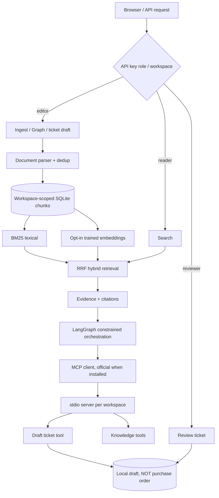

# Architecture and data flow — v2

## Data and trust boundaries

1. API is **not reachable with data** without a valid token in `APP_API_KEYS`. Each token is mapped to one workspace and role. Caller cannot override workspace in JSON or URL.
2. Data isolation is enforced by SQL predicates for documents, chunks, tickets and audit. The MCP subprocess receives a trusted workspace via inherited local process environment. Exposing the stdio process to arbitrary OS users is unsafe.
3. All uploaded files are untrusted reference material, not agent instructions. File type/size, PDF page count, encoding and parsed character length are checked. No file is saved to an executable upload directory; only extracted text goes into SQLite.
4. Context chunks are passed to the optional language model with explicit instruction to treat them as untrusted; outputs must have at least one citation belonging to the retrieval set, otherwise the system falls back to excerpts. **This is not a formal hallucination or injection guarantee.**
5. Agent tools are allow-listed. No unrestricted shell, external integrations, mail, money movement, or order placement. The ticket tool writes **draft only**. A reviewer-scoped HTTP endpoint changes local ticket status.
6. Python code outside API (CLI, direct MCP subprocess) assumes a trusted local user; it is not an externally authenticated service. A production implementation would need OIDC, a vault, scoped per-tenant service identity, TLS, robust idempotency, DLP, and operating controls.
7. The default retriever scans tenant chunks in SQLite; an actual deployment would use an indexed vector database, background ingestion queue, rate limits, tracing sink and retention policies.

## Failure behavior

- Invalid document or unsupported format → HTTP 400, no partial document stored.
- Duplicate SHA in same workspace → `duplicate: true`, no new chunks.
- Provider unavailable → explicit `vector_index` status; lexical retrieval still available.
- No reliable evidence → evidence refusal; no ticket draft.
- Tool timeout → response `mode: tool_error`; no intentional purchase action.
- Cross-workspace ticket, document or approval request → not found / no modification.
- Unauthorized writer or reviewer → HTTP 403.
- Approving a previously approved/rejected ticket → HTTP 409.

See `docs/security.md` for remaining gaps.
